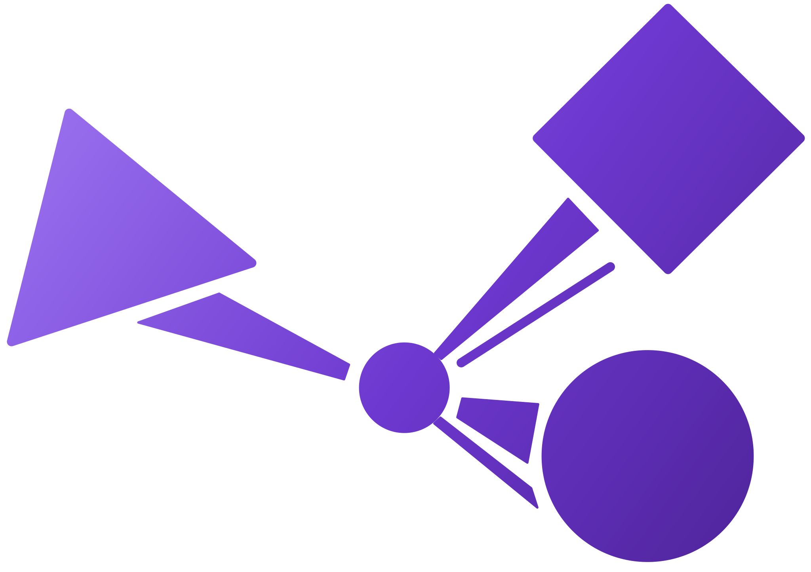

<div align="center">



# Aeon Server Explorer

**A self-hosted web UI for running Docker on your own server, built full-stack in Rust.**

[](https://github.com/aeonroamer/aeon-server-explorer/actions/workflows/ci.yml)


</div>

See every compose project and container at a glance, read live logs and CPU/RAM, start, stop
and redeploy services, build new stacks from a form instead of hand-written YAML, manage images
and volumes, and keep an audit log of every change. It's made for one admin on one machine: it
listens only on loopback and is reached through an SSH tunnel.

## Highlights

- **Full-stack Rust:** one crate compiles to a native Axum server *and* a WebAssembly client.
  Pages render on the server, then hydrate in the browser, and share types and validation from
  a `shared` crate.
- **Live data over Server-Sent Events:** container logs, CPU/RAM and image pulls stream from
  Docker through Tokio tasks that shut down the moment the browser disconnects.
- **Compose stacks from a form:** services, ports, storage, env, restart policy and run-as user
  become a generated `compose.yml`, deployed with one **Save & deploy**, with the full output
  of the last deploy kept.
- **Security-first design:** loopback-only binding, a Host-header guard against DNS rebinding,
  Argon2id passwords with lockout, hashed `__Host-` session tokens, and a hardened stack
  generator with no privileged mode, host networking or socket mounts.
- **Image and volume tooling:** Docker Hub search and pulls with live progress, uploads of
  `docker save` archives streamed straight into Docker with no copy on disk, and a file browser
  for volumes that works through sandboxed, network-less helper containers.
- **Append-only audit log:** sign-ins, actions, deploys, pulls and revealed secrets, each with
  who, IP, target and result.

## Features

| Area | What you can do |
|---|---|
| **Overview** | A status headline, one square per container, a "Needs you" list with one-click fixes, recent activity and project tiles |
| **Projects & services** | Health, ports (with a warning for anything beyond localhost), networks, mounts, env names, live logs and CPU/RAM; Start, Stop, Restart, Redeploy |
| **Managed stacks** | A workbench to add and edit services from installed images, a changes bar (Save, Discard, Apply), and the last deploy's output |
| **Storage files** | Browse, download, upload and delete files in a volume, or copy one volume into another while keeping file owners |
| **Images** | Images on the server and their usage, Docker Hub search with tags, pulls, uploads, and a warning when an image's CPU platform doesn't match the server |
| **Audit log** | Filter by problems, changes or sign-ins, and search |

Full walkthrough in [docs/features.md](docs/features.md).

## Architecture

```
browser ──SSH tunnel──▶ 127.0.0.1:5050 ─┐
                                         ▼
                ┌────────── aeon-server-explorer ──────────┐
                │ guards: Host check → session check        │
                │ Leptos pages (SSR + hydrate)              │
                │ server functions   (/api/...)             │
                │ live streams (SSE) (/api/logs|stats|pull) │
                │ backend: db · docker · stacks · images    │
                └──────┬───────────────┬───────────────┬────┘
                       ▼               ▼               ▼
                explorer.db     Docker engine     stack folders
             (users, audit)  (/var/run/docker.sock) (STACKS_DIR)
```

| Crate | Role |
|---|---|
| root (`src/`) | Axum server, Leptos pages and components, server functions, guards |
| `backend/` | SurrealDB, Docker (bollard), stacks on disk, Docker Hub |
| `shared/` | Types and validation used by both server and browser |

More in [docs/architecture.md](docs/architecture.md).

## Tech stack

| Layer | Tools |
|---|---|
| Language | Rust (native + `wasm32-unknown-unknown`) |
| Web | Leptos 0.8 (SSR + hydration), Axum 0.8, Tokio, Server-Sent Events |
| Docker | bollard (Engine API), `docker compose` |
| Data | SurrealDB 3, embedded (SurrealKV), schema and auth logic in SurrealQL |
| Security | Argon2id, SHA-256 session tokens, `__Host-` cookies |
| UI | SCSS, Lucide icons |
| Build & ship | cargo-leptos, multi-stage Dockerfile, hardened compose deploy |

## Security

Whoever controls Docker controls the server, so the app is built never to be exposed:

- Refuses to start on anything but a loopback address; reached only through `ssh -L`.
- Answers 403 to any request whose `Host` isn't `localhost`/`127.0.0.1` (blocks DNS rebinding).
- One admin, no sign-up, forced password change on first login, 5-try lockout, timing-safe
  login for unknown emails.
- Sessions are 256-bit random tokens stored only as SHA-256, `HttpOnly; Secure; SameSite=Strict`,
  with idle and absolute timeouts.
- `docker compose` runs with explicit arguments, never through a shell; the browser sends only
  names, and all paths are looked up on the server.
- Env values live in files with mode `0600` and are sent to the browser only when revealed,
  which is audited.
- The container itself runs as a non-root user with a read-only filesystem and `no-new-privileges`.

The full threat model is in [docs/security.md](docs/security.md).

## Quick start

Needs Rust (stable), [`cargo-leptos`](https://github.com/leptos-rs/cargo-leptos), the
`wasm32-unknown-unknown` target and a running Docker engine.

```powershell
Copy-Item .env.example .env      # set ADMIN_EMAIL and ADMIN_PASSWORD
cargo leptos watch
```

Open **http://localhost:5055**, sign in, and choose a new password (12+ characters).

To run it on a server, see [docs/deployment.md](docs/deployment.md).

## Documentation

| Doc | Contents |
|---|---|
| [Features](docs/features.md) | Every page and what you can do there |
| [Architecture](docs/architecture.md) | Crates, request flow, live streams, data |
| [Managed stacks](docs/managed-stacks.md) | How the form becomes a compose file and gets deployed |
| [Security](docs/security.md) | The threat model and every guard in place |
| [Deployment](docs/deployment.md) | Building the image, running it on a server, the SSH tunnel |
| [Development](docs/development.md) | Running locally, project layout, gotchas |

## Roadmap

- [x] Storage browser for volumes
- [ ] Smarter ports: detect the port an image listens on, and check that a host port is free
- [ ] Cloudflare Tunnel: run `cloudflared` from a token and publish chosen ports (the explorer
  itself stays SSH-only)
- [ ] Scheduler: run an image on a schedule, with each run's log and catch-up after downtime
- [ ] Backups: share a volume read-only with a backup image that copies it to R2, B2 or S3
- [ ] Delete a stack from the UI
- [ ] Show which containers use an image before removing it

## Author

Built by **Asad Ali** ([@aeonroamer](https://github.com/aeonroamer)), Aeon Logics.

## License

[MIT](LICENSE) © 2026 Asad Ali, Aeon Logics
